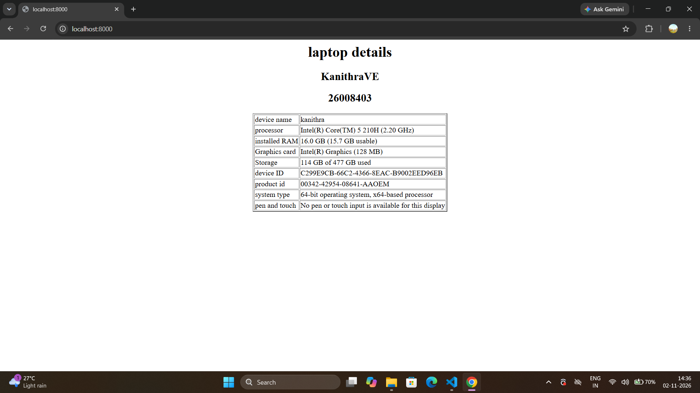
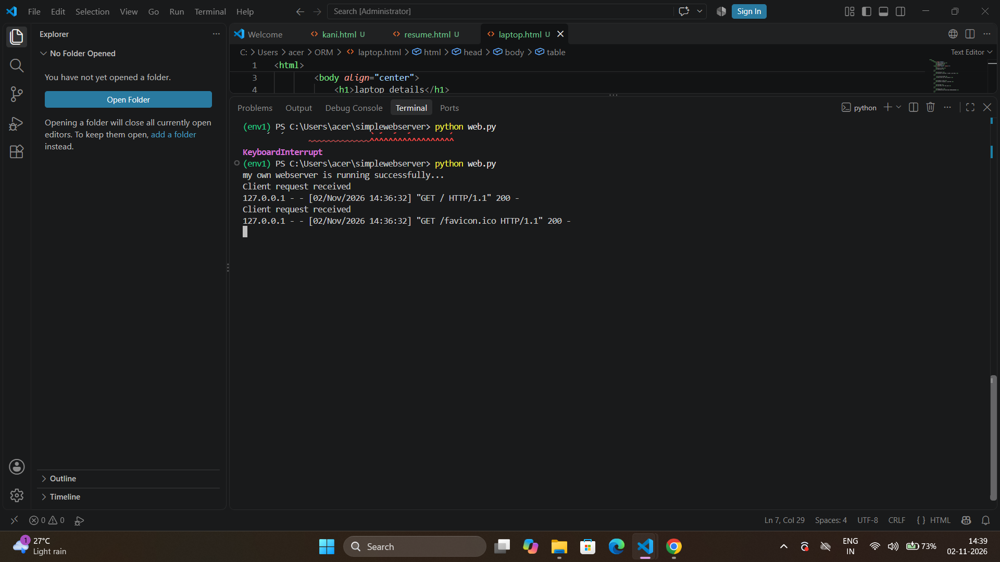

Developing a Simple Webserver
## Date:
28.06.26
## AIM:
To develop a simple webserver to serve html pages and display the Windows Specifications of your Laptop.

## DESIGN STEPS:
### Step 1: 
HTML content creation.

### Step 2:
Design of webserver workflow.

### Step 3:
Implementation using Python code.

### Step 4:
Import the necessary modules.

### Step 5:
Define a custom request handler.

### Step 6:
Start an HTTP server on a specific port.

### Step 7:
Run the Python script to serve web pages.

### Step 8:
Serve the HTML pages.

### Step 9:
Start the server script and check for errors.

### Step 10:
Open a browser and navigate to http://127.0.0.1:8000 (or the assigned port).

## PROGRAM:
```
web.py
from http.server import HTTPServer, BaseHTTPRequestHandler
content = """
<html>
    <head>
        <body align="center">
            <h1>laptop details</h1>
            <h2>KanithraVE</h2>
            <h2>26008403</h2>
        <table align="center" border="2">
            <tr>
            <td>device name</td>
            <td>kanithra</td>
        </tr>
        <tr>
            <td>processor</td>
            <td>Intel(R) Core(TM) 5 210H (2.20 GHz)</td>
        </tr>
        <tr> 
             <td>installed RAM</td>
             <td>16.0 GB (15.7 GB usable)</td>
        </tr>
        <tr>
            <td>Graphics card</td>
            <td>Intel(R) Graphics (128 MB)</td>
        </tr>
        <tr>
            <td>Storage</td>
            <td>114 GB of 477 GB used</td>
        </tr>
        <tr>
            <td>device ID </td>
            <td>C299E9CB-66C2-4366-8EAC-B9002EED96EB</td>
        </tr>
        <tr>
            <td>product id</td>
            <td>00342-42954-08641-AAOEM</td>
        </tr>
        <tr>
            <td>system type</td>
            <td>64-bit operating system, x64-based processor</td>
        </tr>
        <tr>
            <td>pen and touch</td>
            <td>No pen or touch input is available for this display</td>
        </tr>
        </table>
    </body>
    </html>
"""
class myhandler(BaseHTTPRequestHandler):
    def do_GET(self):
        print("Client request received")
        self.send_response(200)
        self.send_header('content-type', 'text/html; charset=utf-8')
        self.end_headers()
        self.wfile.write(content.encode())
server_address = ('',8000)
httpd = HTTPServer(server_address,myhandler)
print("my own webserver is running successfully...")
httpd.serve_forever()
```
## OUTPUT:
web page 

server page

## RESULT:
The program for implementing simple webserver is executed successfully.
